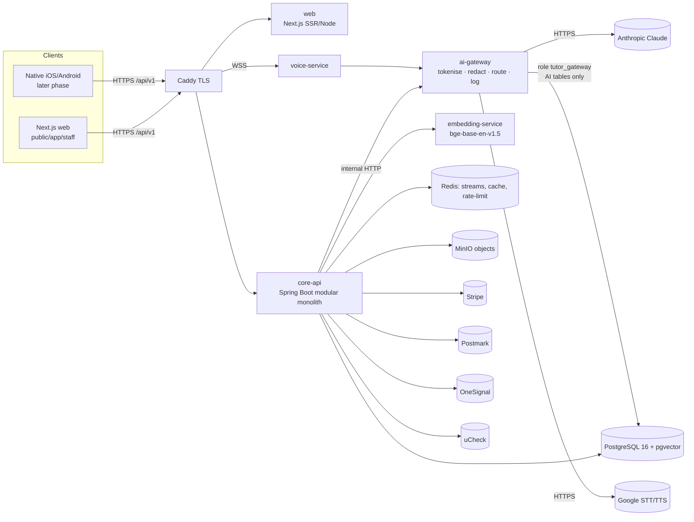

# 03 · System Architecture

## 1. Deployables (Docker Compose on Hetzner; Caddy in front)

## 2. `core-api` modules (Maven) — package `com.karsaaz.studyloop.<module>`
| Module | Owns | Key tables (V00x) |
|---|---|---|
| `platform` | config, feature flags, audit, outbox, jobs, error model, i18n | app_config, feature_flag, audit_log, outbox_event |
| `identity` | accounts, roles, sessions, MFA, OIDC, picture PIN, age assurance | V002 |
| `consent` | legal docs, consent records, voice consent, cookies, privacy, deletion/export | V002 |
| `catalog` | quals, boards, subjects, specs, topics, exam dates, pricing catalogue | V001 |
| `billing` | Stripe integration, subscriptions, entitlements, invoices, dunning, promo, referral | V003 |
| `content` | questions, mark schemes, calc templates, past papers, ingestion, generation, QC, revision content, CMS | V004 |
| `learning` | enrolments, practice/diagnostic/mock/entrance sessions, weekly plan, daily goals | V005 |
| `marking` | marking orchestration, exceptions, reviews (A-Level), disputes, gold set | V005 |
| `mastery` | BKT/IRT/FSRS, misconceptions, predicted grades, benchmarks, strategy controller | V005 |
| `engagement` | events, nudges, surprise quizzes, alerts | V005/V008 |
| `tutor` | tutor sessions, hints, re-explain, explain-back, photo walkthrough | V006 |
| `safety` | classification orchestration, flags, disclosures, DSL actions | V006 |
| `reporting` | weekly reports, notifications, devices, parent/student home aggregates | V008 |
| `school` | classes, assignments, insights, onboarding, SSO, DPA, PO/invoices, KCSIE | V007 |
| `support` | support console, in-house chat, help centre | V008 |
| `aiops` | eval, gold-set, prompt/model config (Q-*), cost, gateway-log views | V006 |
| `gatewayclient` | typed client for ai-gateway (only place that calls it) | — |

**Rules:** modules talk through published interfaces (`api` package) or domain events; no cross-module table access (ArchUnit test). Controllers thin; services transactional; DTOs separate from persistence records. `aiops`/`safety` are the only modules allowed to read `ai_*` tables directly.

## 3. AI Gateway (separate process — the D-15 boundary)
- Endpoints `GW-01…08` (service-to-service, never public). Accepts `{promptId, version, variables, schemaRef, requestId}`; core-api has **already** removed personal data. Gateway adds defence in depth: regex/NER redaction of free text, EXIF strip + face/text-PII masking for images, per-request random token (never a stable user id), model routing from `model_routing`, structured-output enforcement, retries, budget checks (`ai_budget`), logging to `ai_gateway_log` and the exact redacted outbound payload to `ai_gateway_payload` (14-day purge).
- DB role `tutor_gateway` can read only `prompt_version`, `model_routing` and write only AI-ops tables. It **cannot** read learner tables → the boundary is a DB guarantee (V011).
- Mapping request→learner (`ai_request_map`) lives on core-api side; the gateway never has it.
- Daily `boundary_attestation` job: samples outbound payloads and asserts no PII patterns; result surfaced in Q-02.

## 4. Data flows that matter
1. **Answer → mark:** `PRA-04` stores `student_response` → outbox event → marking orchestrator (code pre-checks → gateway Pass A/B → validate → result) → SSE to client → event to mastery consumer.
2. **Nightly generation:** JobRunr → planner (coverage gaps) → batch via gateway → code checks C1–C10 → QC1–5 → APPROVED or E-01 queue.
3. **Reports:** weekly job → facts (code) → gateway narrative → validate → email (Postmark) + in-app.
4. **Voice:** WebSocket → voice-service → STT (Google via gateway) → safety → tutor → safety → TTS → stream back.

## 5. Environments
`local` (docker compose up: postgres+pgvector, redis, minio, mailpit, stubbed gateway with recorded fixtures) · `dev` · `staging` (prod-like, synthetic data only) · `prod`. Secrets via Docker secrets/`.env` not committed. Prod DB roles set by infrastructure, not migrations.

## 6. Capacity & performance targets (starting values)
p95 API read < 300 ms; p95 GCSE mark < 8 s; voice first audio < 1.5 s; 5k concurrent students at pilot scale on a single Hetzner node pair; nightly generation completes < 6 h.
