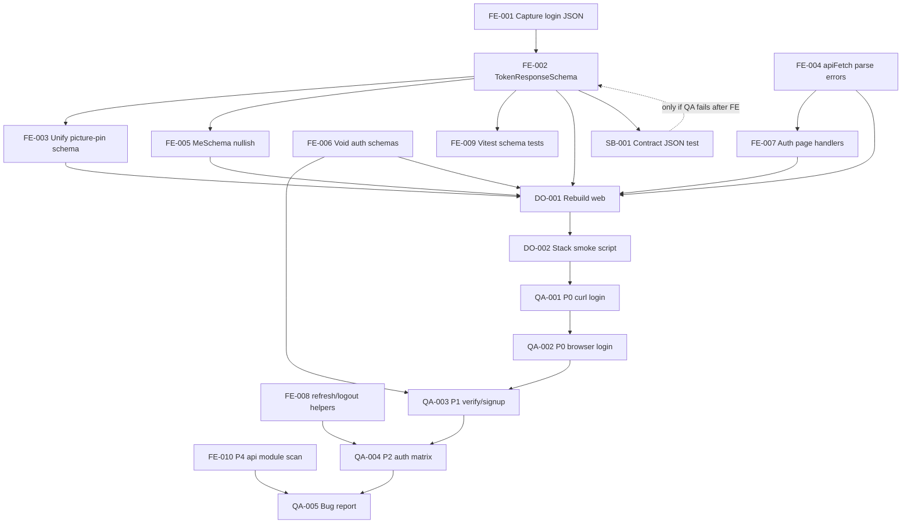

# Master Plan — Auth Frontend↔Backend Wiring Audit

**Requirements baseline:** `docs/requirements-auth-wiring-audit.md`  
**Repo root:** `online_tutor_build_pack`  
**Priority:** P0 login → P1 auth matrix → P2 remaining auth → P3 apiFetch/helpers → P4 sample callers → Docker rebuild

---

## Mandatory consultation gate (complete)

### Architect (confirmed)

| Decision | Rationale |
|----------|-----------|
| **Root cause (prime suspect)** | `backend/core-api/src/main/resources/application.yml` sets `spring.jackson.default-property-inclusion: non_null`. Successful `TokenResponse` JSON **omits** null fields (e.g. `mfaChallengeToken`). Frontend `TokenResponseSchema` uses `z.string().nullable()` which **requires keys** — missing keys → `ZodError` → login page catch → **"Unable to sign in"** despite HTTP 200. |
| **Fix preference** | Harden Zod in `web/src/lib/api/auth.ts` (`.nullish()`, `z.coerce.number()` for `expiresInSeconds`, sensible defaults for booleans/strings). Reuse one exported schema in `auth-extra.ts` for picture-pin. **Do not** rename Java DTOs unless QA proves FE fix insufficient. |
| **apiFetch** | Keep empty-body handling (200/202/204/205); add optional `safeParse` path or `SchemaParseError` for diagnosability without leaking tokens in UI. |
| **Scope** | Minimal diffs; no refactors outside auth wiring + targeted regression tests. |
| **Canonical API URL (Docker)** | Browser/curl: `http://localhost:8080/api/v1` (Caddy). Direct core-api: `8081`. |

### QA Lead (confirmed)

| Area | Acceptance focus |
|------|------------------|
| **P0 login** | curl 200 + JSON with `accessToken`; browser no "Unable to sign in"; tokens in `sessionStorage`; redirect `/home` (or MFA staff flow). |
| **Accounts** | Verify **ACTIVE** status for `murtzamlk1@gmail.com` and `murtzamlk@gmail.com` before blaming wiring (unverified → real 4xx, out of scope). |
| **Per flow** | Record HTTP status, body length, UI message; 202/204 empty must not throw; 401/429 remain `ApiError`. |
| **Forgot password** | 202 empty → success UI always (no enumeration). |
| **Deliverable** | Compact bug report: `file:line`, root cause, fix, curl + browser steps. |

**Design Lead:** not active — skipped.

---

## Domain task files

| Domain | File | Lead |
|--------|------|------|
| Frontend | `docs/tasks-frontend-auth-wiring.md` | frontend-lead |
| Spring Boot | `docs/tasks-springboot-auth-wiring.md` | springboot-lead |
| DevOps | `docs/tasks-devops-auth-wiring.md` | devops-lead |
| QA | `docs/tasks-qa-auth-wiring.md` | qa-lead |

---

## Dependency graph (execution order)

---

## Ordered task index (all domains)

| Order | ID | One-line | Owner |
|-------|-----|----------|-------|
| 1 | FE-001 | Capture live login JSON vs Zod failure mode | frontend-lead |
| 2 | FE-002 | Fix `TokenResponseSchema` for Jackson `non_null` | frontend-lead |
| 3 | FE-009 | Vitest: parse sample backend login/MFA JSON | frontend-lead |
| 4 | FE-003 | Picture-pin uses shared `TokenResponseSchema` | frontend-lead |
| 5 | FE-004 | `apiFetch` + `SchemaParseError` / safeParse | frontend-lead |
| 6 | FE-005 | `MeSchema` nullish alignment for `/me` | frontend-lead |
| 7 | FE-006 | Void/empty schemas for verify/forgot/reset | frontend-lead |
| 8 | FE-007 | Auth pages: distinguish parse vs network errors | frontend-lead |
| 9 | FE-008 | Add `refresh` + `logout` client helpers | frontend-lead |
| 10 | FE-010 | Scan `settings.ts` / `billing.ts` / `w2.ts` empty-body risk | frontend-lead |
| 11 | SB-001 | Spring test: login JSON omits nulls (contract doc) | springboot-lead |
| 12 | SB-002 | Backend DTO fix (conditional, QA-blocked only) | springboot-lead |
| 13 | DO-001 | Rebuild `studyloop` `web` image after FE merge | devops-lead |
| 14 | DO-002 | Optional rebuild `core-api` if SB-002 touched | devops-lead |
| 15 | DO-003 | Compose health + auth curl smoke script | devops-lead |
| 16 | QA-001 | P0 curl login on 8080 for ACTIVE accounts | qa-lead |
| 17 | QA-002 | P0 browser login + sessionStorage + `/home` | qa-lead |
| 18 | QA-003 | P1 signup → verify-email (Mailpit) | qa-lead |
| 19 | QA-004 | P2 forgot/MFA/picture-pin/student register | qa-lead |
| 20 | QA-005 | Compact wiring bug report artifact | qa-lead |

**SB-002:** `[SEQUENTIAL:depends-on-QA-002]` — execute only if QA-002 still fails after FE-002/FE-004/DO-001.

---

## Team TODO summaries

### Frontend
- [ ] FE-001 — [SEQUENTIAL:first]
- [ ] FE-002 — [SEQUENTIAL:depends-on-FE-001]
- [ ] FE-009 — [SEQUENTIAL:depends-on-FE-002]
- [ ] FE-003 — [SEQUENTIAL:depends-on-FE-002]
- [ ] FE-004 — [PARALLEL]
- [ ] FE-005 — [SEQUENTIAL:depends-on-FE-002]
- [ ] FE-006 — [PARALLEL]
- [ ] FE-007 — [SEQUENTIAL:depends-on-FE-004]
- [ ] FE-008 — [PARALLEL]
- [ ] FE-010 — [PARALLEL:after-P1]

### Spring Boot
- [ ] SB-001 — [SEQUENTIAL:depends-on-FE-002]
- [ ] SB-002 — [SEQUENTIAL:depends-on-QA-002] (conditional)

### DevOps
- [ ] DO-001 — [SEQUENTIAL:depends-on-FE-002,FE-003,FE-004,FE-005,FE-006,FE-007]
- [ ] DO-002 — [SEQUENTIAL:depends-on-SB-002] (only if SB-002 run)
- [ ] DO-003 — [SEQUENTIAL:depends-on-DO-001]

### QA
- [ ] QA-001 — [SEQUENTIAL:depends-on-DO-003]
- [ ] QA-002 — [SEQUENTIAL:depends-on-QA-001]
- [ ] QA-003 — [SEQUENTIAL:depends-on-QA-002]
- [ ] QA-004 — [SEQUENTIAL:depends-on-QA-003]
- [ ] QA-005 — [SEQUENTIAL:depends-on-QA-004,FE-010]

---

## Out of scope (reminder)

OIDC, mobile, visual redesign, production deploy, broad non-auth refactors (except FE-010 documented findings).
